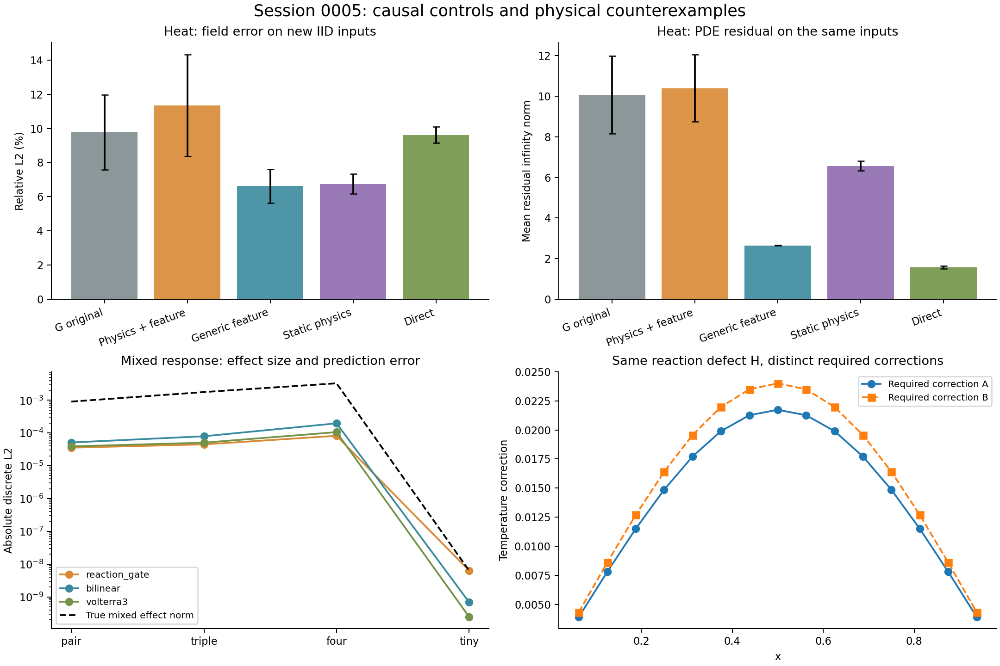

# Session 0005 종합 보고서 — Cycle 24–27

검증된 신규 범용 Architecture 및 Level 3 Primitive는 **없다**. 이번 성과는 G의 정보 흐름을 분리한 통제 실험, F의 제한된 상호작용 표현 검증, 그리고 **같은 nonlinear mixed defect만으로 필요한 상태 보정을 결정할 수 없다는 양수 source 반례**다. 기존 수학과 관련되었다는 이유만으로 후보를 제외하지 않고 계산 graph·학습 규칙·실제 효과를 구분했다.

CPU float64, 학습 seed 2005/2006/2007, Session 0002–0004 파일 1,515개를 보존했다. C0/C0b는 기존 주장에 대한 통제로서 발명 Cycle에 포함하지 않는다. 별도 가설 Cycle은 24,25,26,27의 네 개다. 모든 실험은 작은 1D 문제다. GitHub push, 외부 연구 데이터 전송, 유료 자원, GPU 학습을 수행하지 않았다.

## A. G의 물리 정보 흐름에 대한 통제

**질문:** 구성식 잔차의 반복 공급이 같은 latent에서 일반 feature를 공급하는 것보다 실제로 유리한가? 열반응 `−(kT′)′=Q+λexp(T)`(G)와 정상 이류–확산 `(vu−νu′)′=S`(H)를 각각 학습했다. 이류 flux는 upwind다. N=15, 물리군별 새 train128/validation32, 기존 확인 자료와 checkpoint를 재사용하지 않았다. 훈련·확인 seed 및 사전 범위는 `research/session_0005/preregistered_protocol.md`에 고정했다.

공통 갱신은 `h′=tanh(Wh+Us+tanh(Gh)⊙tanh(Vs))`다. s를 현재 구성식 잔차 r, `r+Ph`, `Ph`, 최초 잔차 r0로 바꿨다. `r+Ph`와 `Ph`는 같은 초기값과 활성 θ=9,472개를 사용한다. 일반 feature도 원래의 전체 물리 입력을 latent를 통해 받는다. Static 모델은 r0를 한 번 계산하고 latent 층은 세 번 거친다. Direct width64는 활성 θ=8,415개, 2,000step이고 나머지는 1,000step이다. Learned Jacobi3는 damping 세 개만 학습한 기존 solver 기준선이다. 완전한 식은 [통제 설계](control_design.md)에 있다.

새 IID 확인 결과(각 64개, 표는 세 seed의 평균 ± **seed 간 표본 표준편차**, 시험 표본의 신뢰구간이 아님):

| 물리군 | 모델 | Field 상대 L2 (%) | PDE 잔차 ∞ 평균 | 구성식 잔차 ∞ 평균 |
|---|---|---|---|---|
| G | original | 9.782 ± 2.2 | 10.06 ± 1.9 | 0.3977 ± 0.083 |
| G | physics_plus_feature | 11.34 ± 3 | 10.4 ± 1.7 | 0.4187 ± 0.074 |
| G | learned_feature | 6.623 ± 0.98 | 2.653 ± 0.0031 | 0.1377 ± 0.014 |
| G | static_physics | 6.745 ± 0.58 | 6.57 ± 0.23 | 0.268 ± 0.0066 |
| G | direct_matched | 9.621 ± 0.48 | 1.571 ± 0.069 | 0.08425 ± 0.0051 |
| G | learned_jacobi | 58.1 ± 8.7e-15 | 1.467 ± 0 | 0 ± 0 |
| H | original | 13.4 ± 3.6 | 1.004 ± 0.11 | 0.08952 ± 0.019 |
| H | physics_plus_feature | 14.25 ± 3.4 | 1.11 ± 0.18 | 0.0914 ± 0.021 |
| H | learned_feature | 14.21 ± 1.7 | 0.7509 ± 0.096 | 0.1033 ± 0.011 |
| H | static_physics | 13 ± 2.1 | 1.152 ± 0.064 | 0.09646 ± 0.0097 |
| H | direct_matched | 30.87 ± 9.9 | 0.838 ± 0.11 | 0.1542 ± 0.034 |
| H | learned_jacobi | 75.76 ± 0 | 0.9985 ± 0 | 0 ± 0 |

열에서는 일반 feature와 static 정보가 원래 G보다 좋은 field 오차를 보였다. 물리 정보를 추가한 `r+Ph`도 `Ph`보다 좋지 않았다. H에서는 원래 G가 generic보다 약간 좋은 평균 field 오차를 보였지만 PDE 잔차 개선은 일치하지 않는다. **물리 feature의 보편적 고유 효과를 입증하지 못했다. 물리 정보가 항상 불필요하다는 결론도 아니다.**

C0를 관측한 뒤 입력 크기/conditioning을 원인 가설로 추가했고, 별도 사전 계획 `normalized_control_protocol.md`와 **새 확인 seed51203/51303**으로 C0b를 수행했다. 같은 train/validation만 사용하고 이전 checkpoint는 변경하지 않았다. `norm(v)=v/sqrt(mean(v²)+1e−12)` 후 `s=norm(norm(Ph)+norm(r))`, generic은 `norm(Ph)`, static은 r0를 사용한다.

| 물리군 | 모델 | 새 확인 Field L2 (%) | 새 확인 PDE ∞ |
|---|---|---|---|
| G | physics_plus_feature | 13.31 ± 2.4 | 10.54 ± 1.2 |
| G | learned_feature | 6.17 ± 0.99 | 2.601 ± 0.045 |
| G | norm_physical | 11.39 ± 2.7 | 9.653 ± 2.6 |
| G | norm_generic | 14 ± 3.6 | 7.659 ± 1.6 |
| G | norm_static | 12.72 ± 1.9 | 8.052 ± 0.37 |
| H | physics_plus_feature | 15.66 ± 3.1 | 0.9316 ± 0.092 |
| H | learned_feature | 18.05 ± 2.6 | 0.6624 ± 0.076 |
| H | norm_physical | 29.72 ± 6.9 | 2.595 ± 1.2 |
| H | norm_generic | 29.79 ± 5.1 | 1.035 ± 0.093 |
| H | norm_static | 21.55 ± 3.9 | 1.422 ± 0.051 |

정규화에 따라 순위가 달라진다. G의 normalized physical은 normalized generic보다 field 오차가 작지만 PDE 잔차가 더 크고, raw generic이 여전히 더 작다. H의 두 normalized 모델은 모두 나빠졌다. 이 조작은 잔차 크기 정보도 제거하므로 보편적 인과 증명으로 확대하지 않는다. 42개 frozen feature trace에서 잔차/사용 feature RMS와 tanh saturation을 기록했다(`posthoc_audit.json`). 이는 확인 후 설명용이며 독립 검증이 아니다.

낮은 물성과 positivity/방향성 전체 결과는 [통제·비용 부록](controls_and_costs.md)에 있다. 대표적으로 원래 G는 low-k에서 field 오차 69.35%, positive-source/BC0에서는 seed별 음수 표본 5/1/6개였다. H의 유속 반전에서 원래 모델은 각 seed 16/16 방향 centroid를 맞혔지만 음수 상태가 생겼다. 방향 centroid 정답은 PDE 해의 정확성을 뜻하지 않는다.

## B. F의 Interaction 학습 메커니즘

새 후보 L/F5는 개별 유한 source의 **response footprint m_i(x)**를 공유 encoder로 생성하고, 반응 중첩 H에서 학습 threshold를 넘는 공간 영역을 활성화한다. 단순한 rank/order 증가는 아니다. 그러나 source pair/subset의 topology를 선택하는 연산을 구현한 것도 아니다.

\[
S=\sum_i m_i,\qquad H=\lambda e^{T_0}[\operatorname{expm1}(S)-\sum_i\operatorname{expm1}(m_i)],\\
\tau_\theta=\operatorname{softplus}(t_0+t_1\lambda/k),\quad
K_\theta=\operatorname{softplus}(W_0+(\lambda/k)W_1+\log k\,W_2),\\
\widehat T=T_0+S+x(1-x)\odot K_\theta[H-\tau_\theta]_+.
\]

공유 encoder는 base/singleton 해만으로 2,000step 학습했다. 다섯 head는 같은 encoder·train128sets·validation32sets를 사용하여 1,000step씩 세 seed 학습했다. 확인 자료는 모든 head 동결 이후 한 번만 평가했다. 자료 생성 시 모든 subset 기준해를 보존했지만 head fit에는 전체 mixed/base/singleton labels를 사용했다. 반복되는 zero/base label을 독립 데이터로 세지 않는다.

| 조건 | Field L2 (%) | 진짜 mixed L2 | Mixed 절대오차 L2 | 진짜 >pair L2 | >pair 절대오차 L2 | 공간 활성 비율 |
|---|---|---|---|---|---|---|
| single | 2.306 ± 0 | 0 | 0 ± 0 | 0 | 0 ± 0 | 0.000 |
| pair | 2.103 ± 3.3e-07 | 0.0009106 | 3.583e-05 ± 4.5e-09 | 3.762e-18 | 3.762e-18 ± 0 | 0.500 |
| triple | 1.928 ± 2.8e-07 | 0.0017818 | 4.499e-05 ± 3.5e-09 | 4.6234e-05 | 2.705e-05 ± 1.7e-09 | 0.525 |
| four | 1.921 ± 8.3e-07 | 0.0032894 | 8.242e-05 ± 4.4e-09 | 0.00018452 | 9.478e-05 ± 3.4e-09 | 0.554 |
| far | 16.69 ± 1.8e-07 | 3.6061e-05 | 1.592e-05 ± 5e-10 | 3.1328e-18 | 3.133e-18 ± 4.7e-34 | 0.271 |
| shift | 29.32 ± 2e-07 | 2.473e-05 | 2.14e-05 ± 1e-09 | 1.6517e-18 | 1.652e-18 ± 0 | 0.254 |
| tiny | 1.993 ± 0 | 6.315e-09 | 6.315e-09 ± 0 | 2.3417e-20 | 2.342e-20 ± 0 | 0.000 |
| linear | 3.893 ± 5.4e-16 | 3.4547e-17 | 3.455e-17 ± 0 | 8.7957e-18 | 8.796e-18 ± 0 | 0.000 |
| lowk_linear | 3.573 ± 0 | 2.7676e-16 | 2.768e-16 ± 0 | 6.3925e-17 | 6.392e-17 ± 0 | 0.000 |

`mixed = T_all−T0−Σ(T_i−T0)`이며, `>pair`는 mixed에서 모든 pair mixed를 뺀 값이다. M=3에서는 순수 triple, M=4에서는 triple+quadruple 효과다. 표는 λ=0/1.5가 섞인 각 확인 분포 전체의 평균이다. 전체 activation에는 λ=0의 구조적 zero가 포함된다. λ>0만 분리하면 gate 활성 비율은 pair94.12%, triple98.82%, four98.52%, far72.22%, shift67.78%, tiny0%다. 따라서 대부분의 비선형 IID 영역은 계속 활성화되며 강한 source별 선택성이 입증된 것이 아니다. 절대 norm은 무차원 **이산 L2**이며 격자 간 같은 정규화 오차라고 간주하지 않는다. 작은 분모 상대오차와 비자명 효과 조건부 오차는 원본 JSON에 함께 있다.

직접 비교에서 pair의 mixed 절대오차는 gate 3.58e−5, bilinear 5.15e−5, cubic 3.91e−5였다. 하지만 triple 고차 오차는 gate 2.70e−5, cubic 1.85e−5이고, four 고차 오차도 cubic이 더 작았다. 작은 source에서는 실제 mixed 크기 6.31e−9를 gate가 전부 지운다. Ungated/cubic의 절대오차는 각각 3.23e−10/2.45e−10으로 더 작다. 따라서 gate를 정확도나 계산량의 보편적인 우위로 평가하지 않는다. [전체 baseline·고차 비교](interaction_comparison.md).

공유 encoder와 head의 오류를 사후에 정확히 분해했다. `전체 오류=encoder 성분 오류+mixed head 오류`이며 두 성분은 직교하지 않는다.

| 조건 | 공유 encoder 성분오차 L2 | Mixed head 성분오차 L2 | 전체 field 절대오차 L2 |
|---|---|---|---|
| pair | 0.00846954 | 3.58325e-05 | 0.00849194 |
| four | 0.014003 | 8.24161e-05 | 0.0140488 |
| shift | 0.0273153 | 2.14023e-05 | 0.0273351 |
| tiny | 0.000574683 | 6.31497e-09 | 0.000574689 |

Source 위치 OOD의 큰 field 오차를 interaction head만의 실패로 돌리면 안 된다. 반대로 상대적으로 작은 mixed 오차를 전체 field 개선이라고 주장할 수도 없다. Low-k 확인은 λ=0이며 `a/k` 구조로 선형 scaling을 넣었다. 비선형 low-k OOD의 성공 근거가 아니다.

## C. 독립 Primitive 가설과 완전한 식

각 후보의 단위·typed 입력·학습 규칙·복잡도·기존 모델 비교를 별도 문서로 보존했다.

1. **J: state/constraint 유한 변화 객체** — [candidate_J.md](../../architectures/session_0005/candidate_J.md). `(T,j;b,c;ΔT,Δj,Δb,Δc)`를 구분한다. `b=Dj−Q−λexp(T)`, `c=j−C_vT−c_g`다.
   \[
   \Delta b=D\Delta j-\lambda e^T\odot\operatorname{expm1}(\Delta T),\quad
   \Delta c=\Delta j-C_v\Delta T,\qquad R_{PDE}=b-Dc.
   \]
   시험한 공동 갱신은 `ΔT=−η(−λexp(T)⊙b−C_vᵀc)`, `Δj=−η(Dᵀb+c)`다. 실제로는 classical least-squares gradient와 같아서 새 NN 학습을 강제하지 않았다. 학습 mobility는 **미실행**이다.
2. **L/F5: nonlinear reaction overlap selector** — [candidate_L.md](../../architectures/session_0005/candidate_L.md). 위 식에 더해 `T0=(λ/k)x(1−x)softplus(f0(λ/k,x))`, `m_i=(a_i/k)x(1−x)softplus(f1(λ/k,λa_i/k,c_i,w_i,x))`다. f0/f1은 두 tanh hidden layer(width32)와 affine 출력이다. Encoder θ=2,466개, gate head θ=677개를 실제 학습했다. Physical reaction law와 BC envelope는 고정했다.
3. **K: 관측 가능한 causal heat state** — [candidate_K.md](../../architectures/session_0005/candidate_K.md). Cattaneo 열식에서 flux를 숨긴 온도 관측의 충분성을 조사했다.
   \[
   z=(a,b)^T,\quad \dot z=\begin{bmatrix}0&-\omega_h\\k\omega_h/\tau&-1/\tau\end{bmatrix}z,\quad
   P=e^{\Delta tA},\quad a_{n+2}=c_1a_{n+1}+c_2a_n.
   \]
   여덟 초기 상태의 이력에서 c1/c2를 최소제곱으로 실제 적합했다. 신경망 학습이 아니다. 완전한 `(T,j)`는 Markov 상태다.

J/L/K는 각각 constraint compatibility, nonlinear finite interaction, causal observability라는 독립 출발점이다. Cycle27은 L의 정보 충분성 반증이며 독립 발명으로 세지 않는다.

## D. 기존 계산과의 수학적·알고리즘적 차이

J의 실제 갱신은 `−ηJ_FᵀF`와 정확히 같다(Level1). 이름이나 입력 객체만 바꿔 새로운 solver라고 부르지 않는다. L은 `Φ(m_i)=(m_i,expm1(m_i))`, sum pooling, Ψ, threshold, positive kernel이라는 graph로 정확히 전개된다. 이 **구체적 동일성**을 frozen checkpoint의 NumPy 계산으로 재구성했다. 일반적인 보편근사 가능성만으로 모든 architecture를 기각한 것이 아니다. 물리 response 표현과 보장은 평가하되, 새 정보 교환 규칙의 근거는 부족하다(Level2).

K의 적합 계수는 Cayley–Hamilton의 `(trace(P),−det(P))`와 최대 5.55e-16 차이다. 이 구현은 AR(2)/선형 관측가능성의 재현(Level1)이다. G 자체는 fixed Jacobi와 정확히 같지는 않지만 일반 gated latent에 residual feature를 넣는 현재 구조의 독자적 이점이 미입증이다.

## E. 실제 물리 검증과 반증

J: 정확한 flux를 유지하고 온도에 작은 고주파 perturbation만 더했다. Field L2가 0.0775%여도 PDE ∞는 0.1014다. 이산 divergence가 오차를 증폭한다. 보존만 정확하다고 온도 해가 정확한 것이 아니다.

| 조건 | Field L2 (%) | 보존 ∞ | 구성식 ∞ | PDE ∞ | 128step Field L2 (%) | 양수 상태의 다음 최소값 |
|---|---|---|---|---|---|---|
| heat | 0.07746 | 1.066e-14 | 0.003169 | 0.10142 | 87.921 | -0.13261 |
| lowk | 0.0007746 | 4.663e-15 | 3.169e-05 | 0.0010142 | 99.998 | -0.0013671 |
| adv_plus | 0.016972 | 7.105e-15 | 0.0004169 | 0.013311 | 99.259 | -0.018077 |
| adv_minus | 0.016972 | 5.329e-15 | 0.0004169 | 0.013311 | 99.259 | -0.017922 |

128step은 zero joint state에서 시작한 별도 classical-gradient 진단이다. 양수 상태의 다음 최소값은 임의 flux를 가진 joint 상태에서의 반례다. 둘을 같은 초기화 실험으로 혼동하지 않는다. Low-k에서는 defect 감소와 state 회복이 분리되고 condition 수가 1,066이다. 실제 finite increment의 balance/constitutive 항등식 오류는 각각 7.44e−15/6.66e−16이었다.

K: 새로운 초기 상태 32개의 AR2 확인 오차 8.33e-17, AR1 0.060052. 같은 순간 온도라도 flux가 다르면 다음 온도 차이 0.135937다. 그러나 alias 간격 0.479425에서는 두 온도 관측 차이가 2.25e-15인데 이후 온도 차이는 0.0410023다. 고정 계수를 dt=0.1에 쓰면 최대 오차 0.0878361다. 완전한 상태의 비Markov성을 증명한 것이 아니다.

### Cycle27 — H-only closure의 물리적 입력 충돌

같은 k=1, λ=1.5, base lower solution에서 `f=4x(1−x)`와 `m_i=log(1+c_i f)`를 쓴다. A는 c=(0.3,0.3), B는 (0.1,0.9)다. 두 경우 `H=λexp(T0)·0.09 f²`가 **해석적으로 동일**하지만 S는 다르다. `Q_i=A_hm_i−λexp(T0)expm1(m_i)`로 각 singleton을 정확한 물리 응답으로 만들었고 Q_i는 모두 양수다. 총 source의 정상해에 필요한 correction은 다르다.

| N | 같은 H의 최대 차이 | 필요 correction의 L2 차이 | H-only 최악 오차 하한 | S를 쓴 1-Newton 상대오차 A/B |
|---|---|---|---|---|
| 15 | 2.08e-16 | 0.006308861 | 0.003154431 | 0.3966%/0.5916% |
| 31 | 4.16e-16 | 0.00885246 | 0.00442623 | 0.3937%/0.5867% |

같은 입력을 같은 출력으로 보내는 H-only closure는 triangle inequality에 따라 두 correction 중 적어도 하나에서 표의 하한 이상 오차를 낸다. 이는 Gaussian 학습분포 밖의 물리적 source 반례이고, 모든 end-to-end network의 불가능성을 뜻하지 않는다. Footprint에 물리적 의미 없는 추가 정보를 숨기면 가정이 달라진다. 두 해상도 모두 반증했지만 norm의 N 의존성을 수렴률이라고 해석하지 않는다. S를 추가한 1-step Newton은 고전 알고리즘이며 새 primitive로 승격하지 않았다. 같은 저장 field에서 보정의 정확한 식도 별도로 전개하고 검증했다.

\[
A_h\delta-\lambda e^{T_0+S}\operatorname{expm1}(\delta)-H=0.
\]

상태 S는 반응계수 `λexp(T0+S)`를 바꾸므로 H만 같은 두 조건에서 correction이 다를 수 있다. `closure_equation_audit.json`의 네 조건에서 이 식을 직접 검사했다. 이는 원래 PDE를 correction 좌표로 쓴 항등식이며 신규 solver나 학습 규칙이 아니다. `(S,H)`와 물리 연산자/base/parameter를 주어도 branch 선택·존재·유일성까지 자동 보장되지는 않는다.

## F. Conservation·구성식·PDE·Positivity·OOD

L은 양수 source/λ≥0/BC0에서 m_i≥0, H≥0, K≥0, 출력≥0 및 source 순열 불변성, singleton mixed=0, λ=0 mixed=0을 구조적으로 보장한다. 부호 있는 냉각 source, 비영 BC, 일반 geometry에 같은 보장을 확장하지 않는다. 보존과 구성식 및 PDE 정확성은 보장하지 않는다.

| 조건 | PDE ∞ 평균 | 물리 flux 에너지 수지오차 | 음수 표본 수 / seed | 고전 ms/batch | 학습형 ms/batch |
|---|---|---|---|---|---|
| pair | 0.4584 | 0.017882 | 0/0/0 | 4.951 | 1.597 ± 0.044 |
| four | 0.62613 | 0.028937 | 0/0/0 | 2.976 | 1.207 ± 0.029 |
| far | 0.37197 | 0.0099962 | 0/0/0 | 2.175 | 1.124 ± 0.084 |
| shift | 0.26545 | 0.025539 | 0/0/0 | 2.187 | 1.106 ± 0.19 |
| tiny | 0.015932 | 0.00087592 | 0/0/0 | 2.31 | 1.175 ± 0.16 |
| lowk_linear | 0.37254 | 0.0094626 | 0/0/0 | 1.28 | 1.236 ± 0.24 |

G 계열의 생성 flux는 수지 오차가 약 기계 정밀도여도 T가 만드는 물리 flux는 다르다. Direct/Jacobi는 이 생성 제약을 공유하지 않으며 Jacobi는 구성식 flux를 직접 계산한다. 모든 BC 오차 0은 두 끝점을 고정한 출력 표현의 성질이다. 학습이 경계값을 발견했다는 뜻이 아니다. 음수 표본 수는 양수 source와 zero BC가 요구되는 입력에서만 계산했다. 정확한 고전 해와 독립 dense 재검증은 이 한계를 숨기는 baseline이 아니다.

2D/새 geometry/다른 resolution의 **학습형** 결과, Stokes/비압축성 momentum, RANS/HVAC, GPU 학습은 미실행이다. 현재 1D 잔차·OOD 문제가 해결되지 않아 확장하지 않았다. 정상 scalar 이류–확산을 비압축성 유동 검증이라고 부르지 않는다.

## G. 계산 비용·공정 비교·재현성

[통제·비용 부록](controls_and_costs.md)과 [Interaction 비교](interaction_comparison.md)에 활성 θ, 실제 학습 초, profiler 연산, 추론 시간을 기록했다. G physics-plus/generic의 활성 θ는 같아도 물리 flux 계산 때문에 실제 연산은 다르다. Direct는 2배 step으로 근사적인 연산 예산을 맞췄으나 완전 동등하지 않다. Learned Jacobi의 초기 θ는 모든 seed에서 같아 세 결과를 독립 초기화 변동으로 해석하면 안 된다.

F의 singleton encoder 2,466개 θ, 학습 24.717초, profile train batch 66.281 MOp를 head 비용과 별도로 기록한다. Head 학습에서는 frozen footprint를 미리 계산하고, **추론 시간에는 입력 tensor 준비와 encoder를 포함**한다. 고차 진단을 위한 pair 재호출은 full-field latency에 포함하지 않는다. Dataset 생성 비용은 manifest에 있다. 모든 subset label 생성은 set마다 최대 2^M 기준해가 필요하며 실제 fit label 수와 다르다.

F의 이론적 encoder O(MNw²), pooling O(MN), dense kernel O(N²), 저장 O(MN+N²)다. Bilinear/cubic도 pooled power identity를 사용하므로 source 수 M에 대해 선형이다. Gate가 0이어도 dense kernel은 계산하므로 관측된 activation 감소는 FLOPs 절감이 아니다. Attention 기준선은 작은 anchored softmax model이며 모든 Transformer/Volterra를 포괄하는 비교는 아니다.

CPU 시간은 batch별 7회 중앙값의 seed 평균이다. 이 작은 CPU 실험에서 batch 추론은 exact root보다 빠른 경우가 있지만 정확도는 같지 않다. 이득의 전처리·학습 상각, 최적화된 vectorized 고전 solver와의 비교는 미완료다. Profile FLOPs는 PyTorch가 지원하는 연산 일부만 세며 exp/reduction 등을 모두 포함하지 않는다. Tracemalloc은 Python 중심으로 native tensor/BLAS peak를 누락하므로 전체 메모리 우월성을 주장하지 않는다.

재현 검증: 70 checkpoints(그중 learned Jacobi 6개 포함), 예측333 batches 및 고전24 batches, 데이터25 files를 검사했다. **2,472개 기준해 비교는 중복 base/subset도 포함하며 독립 물리 표본 수가 아니다.** 별도 dense 행렬/root 구현과 기존 기준해의 최대 차이는 2.19e−11이었다. 최종 검증 결과는 `results/session_0005/validation/integrity.json`, pytest는 54 passed다. Session4의 183 prediction batches/51 models도 결과 복사본에서 먼저 검증했다. 모든 timestamp는 provenance이며 독립된 blind-access 시스템의 증거는 아니다.

최초 J/K/closure 전체 runtime은 별도 기록하지 않아 소급 측정했다고 보고하지 않는다. 같은 저장 조건의 계산을 다시 실행한 시간·Python peak와 dataset label 수/저장 비용은 [보조 재현 계측](cost_reproduction.md)에 있다. 초기 F manifest의 준비 시간에는 추가 low-k 조건 생성 시간이 포함되지 않는다. 전체 native activation peak는 미계측이다.

## H. 후보 판정과 현재 최고 연구 객체

| 후보 | 판정 | Level | 근거 |
|---|---|---|---|
| G 통제 | 고유 정보 흐름 우위 UNRESOLVED | 기존 Level2 유지 | 조건/정규화/지표에 따라 결과가 다르며 물리적 결함이 남음 |
| J | 현 갱신 REJECT | 1 | 실제 알고리즘이 least-squares defect correction, positivity 반례 |
| L/F5 | REVISE | 2 | 해석 가능한 finite response/positivity는 유용하나 pooled-set graph, tiny/high-order/OOD 및 H-only 한계 |
| K | 현 갱신 REJECT | 1 | AR2/관측가능성 동일성과 aliasing 반례 |
| `(S,H)` 표현 | 다음 가설, 미실행 | 미판정 | H-only 반례에서 필요한 state 문맥을 추가하지만 새 학습 메커니즘은 아직 없음 |

현재 최고 **신규 architecture는 없다**. 다음 연구를 위한 가장 구체적인 객체는 집단 상태 S와 nonlinear finite defect H의 쌍이다. L은 제한된 Level2 probe로 보존하고, 새 state-conditioned mechanism을 만들었다고 주장하지 않는다. K의 observability는 독립 도전 질문으로 유지하되 AR2를 재제안하지 않는다.

## I. 논문·특허 신규성

[실제 출처·수식 비교 기록](../../research/session_0005/novelty_review.md)에 읽은 저장 자료와 미확인을 구분했다. DEQ/MeshGraphNets/optimization-layer의 공식 README·코드를 참고했으며 새 원문/특허 검색은 하지 않았다. 기존 403 요청을 반복하지 않았다. 새 이름이나 제한된 baseline 성능으로 신규성·진보성을 판정하지 않는다. 이번 통제와 물리적 불충분성 반례는 연구 기록 가치가 있지만 논문·특허 기여 가능성은 추가 문헌 검토 전까지 미검증이다.

## J. 다음 세션

[정확한 재개 순서와 명령](../../research/session_0005/next_steps.md)을 저장했다. Session0006은 Cycle28부터 시작한다. (1) 이 세션을 재학습 없이 검증하고, (2) `(S,H)`가 필요한 최소 정보를 규명하며, (3) 기존 Newton/learned correction과 다른 학습 흐름을 수식으로 만들 수 있을 때만 새로운 모델을 만든다. 새 확인 seed와 분포를 사전 등록하고 Session5 확인 결과를 모델 선택에 재사용하지 않는다. 독립 challenger는 완전한 state와 관측의 차이를 다루되 고전 memory/AR2를 이름만 바꾸지 않는다.

네 Cycle에서 의미 있는 반증과 정보 충분성 결과를 확보했다. 다음 필요한 것은 더 큰 F/G 학습이 아니라 새로운 계산 규칙과 최근접 문헌 대조이므로, 의미 없는 Cycle을 채우거나 CFD로 확대하지 않고 여기서 중단한다. 현재 확인 집합은 이미 관측되었으며 다음 연구의 untouched test가 아니다. 전체 재학습 wrapper를 다시 실행하지는 않았고, ROOT 분리 smoke에서 J/K/closure의 배열55개를 원본과 비교해 통과했다. 개별 학습·확인 phase는 이번 연구에서 실제 실행했다.
